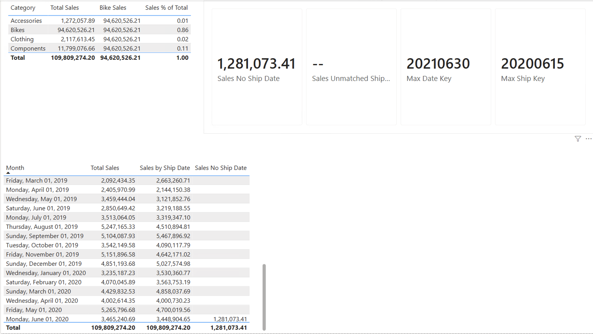

# Power BI – AdventureWorks: Star Schema ve CALCULATE

Çok tablolu bir satış modelinde `CALCULATE` ile filtre bağlamını değiştirmek, pasif ilişkileri kullanmak ve bir veri kalitesi sorununu (kargo tarihi boş satışlar) ölçerek açıklamak.



## Veri seti
- **Kaynak:** Microsoft Power BI örneği – [AdventureWorks Sales.xlsx](https://github.com/microsoft/powerbi-desktop-samples/tree/main/AdventureWorks%20Sales%20Sample)
- **Model:** 1 fact tablo (`Sales`), 6 dimension tablo (`Customer`, `Date`, `Product`, `Reseller`, `SalesOrder`, `SalesTerritory`)
- **Şema tipi:** Star schema. Bütün dimension tabloları doğrudan `Sales`'e bağlı, dimension'lar arasında zincirleme ilişki yok.

## Model
1. **Power Query:** Sadece tablolar yüklendi (`_data` sayfaları hariç). Sütun tipleri *Detect Data Type* ile ayarlandı; `...Key` sütunları tam sayı, tutar sütunları ondalık.
2. **Tarih ilişkileri:** `Sales` tablosunda üç tarih anahtarı var. Power BI iki tablo arasında aynı anda tek aktif ilişkiye izin verdiği için:

   | İlişki | Durum |
   |---|---|
   | `Date[DateKey]` → `Sales[OrderDateKey]` | Aktif |
   | `Date[DateKey]` → `Sales[DueDateKey]` | Pasif |
   | `Date[DateKey]` → `Sales[ShipDateKey]` | Pasif |

3. `Date` tablosu `Date[Date]` sütunuyla *Mark as date table* olarak işaretlendi.

## CALCULATE
`CALCULATE`, measure'ı hesaplamadan önce hücrenin filtre bağlamını değiştirir. Üç kullanımı:

```dax
Total Sales = SUM ( Sales[Sales Amount] )

-- 1. Filtre değiştirmek: Category filtresi her satırda Bikes'a çevrilir
Bike Sales = CALCULATE ( [Total Sales], Product[Category] = "Bikes" )

-- 2. Filtre silmek: payda, ürün filtreleri kaldırılmış toplam satış
Sales % of Total =
DIVIDE ( [Total Sales], CALCULATE ( [Total Sales], ALL ( Product ) ) )

-- 3. İlişki değiştirmek: pasif ShipDate ilişkisi bu hesap için aktif edilir
Sales by Ship Date =
CALCULATE ( [Total Sales], USERELATIONSHIP ( Sales[ShipDateKey], 'Date'[DateKey] ) )
```

| Kategori | Total Sales | Toplamdaki payı |
|---|---|---|
| Bikes | 94,620,526 | %86.2 |
| Components | 11,799,077 | %10.7 |
| Clothing | 2,117,613 | %1.9 |
| Accessories | 1,272,058 | %1.2 |
| **Toplam** | **109,809,274** | |

**Notlar:**
- `CALCULATE` yalnızca belirtilen sütundaki filtreyi değiştirir. Örneğin Country = France seçiliyken `Bike Sales` Fransa'daki bisiklet satışlarını verir.
- `ALL` silmek istenen filtrenin geldiği tabloya uygulanmalı. `ALL(Sales)`, Sales'e ilişkiler üzerinden gelen bütün filtreleri (ürün, tarih, bölge) siler; `ALL(Product)` ise yalnızca ürün filtrelerini.
- Sipariş tarihine ve kargo tarihine göre satışlar aylar arasında farklı dağılıyor, ama iki toplam aynı (109,809,274). Satışlar aynı, yalnızca hangi aya yazıldıkları değişiyor.

## Veri kalitesi: Kargo tarihi olmayan satışlar
Kargo tarihine göre gruplanan matrix'te, ayı boş olan bir satırda **1,281,073.41** satış görünüyordu. İki hipotez ölçüldü:

```dax
-- Kargo tarihi boş olan satışlar
Sales No Ship Date =
CALCULATE ( [Total Sales], ISBLANK ( Sales[ShipDateKey] ) )

-- Kargo tarihi dolu ama Date tablosunda karşılığı olmayan satışlar
Sales Unmatched Ship Date =
CALCULATE (
    [Total Sales],
    FILTER (
        Sales,
        NOT ISBLANK ( Sales[ShipDateKey] )
            && ISBLANK ( LOOKUPVALUE ( 'Date'[DateKey], 'Date'[DateKey], Sales[ShipDateKey] ) )
    )
)

Max Ship Key = MAX ( Sales[ShipDateKey] )
Max Date Key = MAX ( 'Date'[DateKey] )
```

| Kontrol | Sonuç |
|---|---|
| Sales No Ship Date | 1,281,073.41 |
| Sales Unmatched Ship Date | boş (eşleşmeyen anahtar yok) |
| Max Ship Key | 20200615 |
| Max Date Key | 20210630 |

- **Mutabakat:** Boş satırdaki tutarın tamamı kargo tarihi olmayan satışlardan geliyor (1,281,073.41 = 1,281,073.41).
- **Eşleşmeyen anahtar yok:** Son kargo tarihi (15 Haziran 2020), Date tablosunun aralığı içinde.
- **Kargo tarihi olmayan satışların hepsi Haziran 2020'de, verinin son ayında sipariş edilmiş.** Son kargo tarihi 15 Haziran 2020 olduğuna göre bu siparişler veri kesildiğinde henüz kargolanmamış açık siparişler. Bu hipotez veriyle güçlü şekilde destekleniyor.

**Öneri:** Bu tutar bir veri hatası değil, açık sipariş. Kargo tarihine göre raporda boş satır yerine "Kargolanmadı" olarak gösterilmeli. Data warehouse tarafında bu, Date tablosuna "Not shipped" anlamında bir `-1` satırı eklenip boş anahtarların ona eşlenmesiyle yapılır.

## Dosyalar
| Dosya | Açıklama |
|---|---|
| `101_adventureworks_calculate.pbix` | Power BI Desktop dosyası |
| `101_report.png` | Rapor ekran görüntüsü |
| `101_README.md` | Bu dosya |

**Kullanılan araçlar:** Power BI Desktop, Power Query, DAX (`CALCULATE`, `ALL`, `USERELATIONSHIP`, `FILTER`, `LOOKUPVALUE`)
