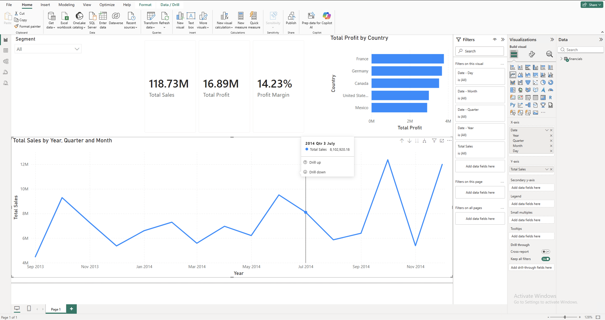

# Power BI – Financial Dashboard

İlk Power BI çalışmam: tek tablolu bir satış verisinden KPI kartları, trend ve kırılım grafikleri olan interaktif bir dashboard.



## Veri seti
- **Kaynak:** Microsoft Power BI örnek verisi – *Financial Sample* (`Financial Sample.xlsx`, tablo: `financials`)
- **Kapsam:** Ülke, segment, ürün ve indirim bandı bazında satış, maliyet ve kâr; Eylül 2013 – Aralık 2014 (16 ay)

## Yapılanlar
1. **Power Query:** Veri Excel'den alındı, sütun tipleri (tarih, ondalık sayı) kontrol edildi.
2. **DAX measure'ları:**
   ```dax
   Total Sales   = SUM(financials[Sales])
   Total Profit  = SUM(financials[Profit])
   Profit Margin = DIVIDE([Total Profit], [Total Sales])
   ```
   Margin, satır bazında oranların ortalaması yerine toplamlar üzerinden hesaplandı; böylece büyük satışlar doğru ağırlıkla yansıyor. `DIVIDE` sıfıra bölmede hata yerine boş değer döndürüyor.
3. **Rapor:**
   - KPI kartları: Total Sales, Total Profit, Profit Margin
   - Aylık satış trendi (line chart, Year → Month hiyerarşisi)
   - Ülkelere göre kâr (bar chart)
   - Segment filtresi (dropdown slicer)

## Genel sonuçlar (filtresiz)
| KPI | Değer |
|---|---|
| Total Sales | 118.73M |
| Total Profit | 16.89M |
| Profit Margin | %14.23 |

**Not:** 2013 yılında yalnızca 4 ay (Eylül–Aralık) var. Bu yüzden 2013 ile 2014'ü yıl bazında karşılaştırmak yanıltıcı olur. Eksende sadece ay adı kullanıldığında da iki yılın aynı ayları üst üste toplanıyor; trend bu nedenle yıl + ay seviyesinde gösterildi.

## Dosyalar
| Dosya | Açıklama |
|---|---|
| `101_financial_dashboard.pbix` | Power BI Desktop dosyası |
| `101_dashboard.png` | Dashboard ekran görüntüsü |
| `101_README.md` | Bu dosya |

**Kullanılan araçlar:** Power BI Desktop, Power Query, DAX
